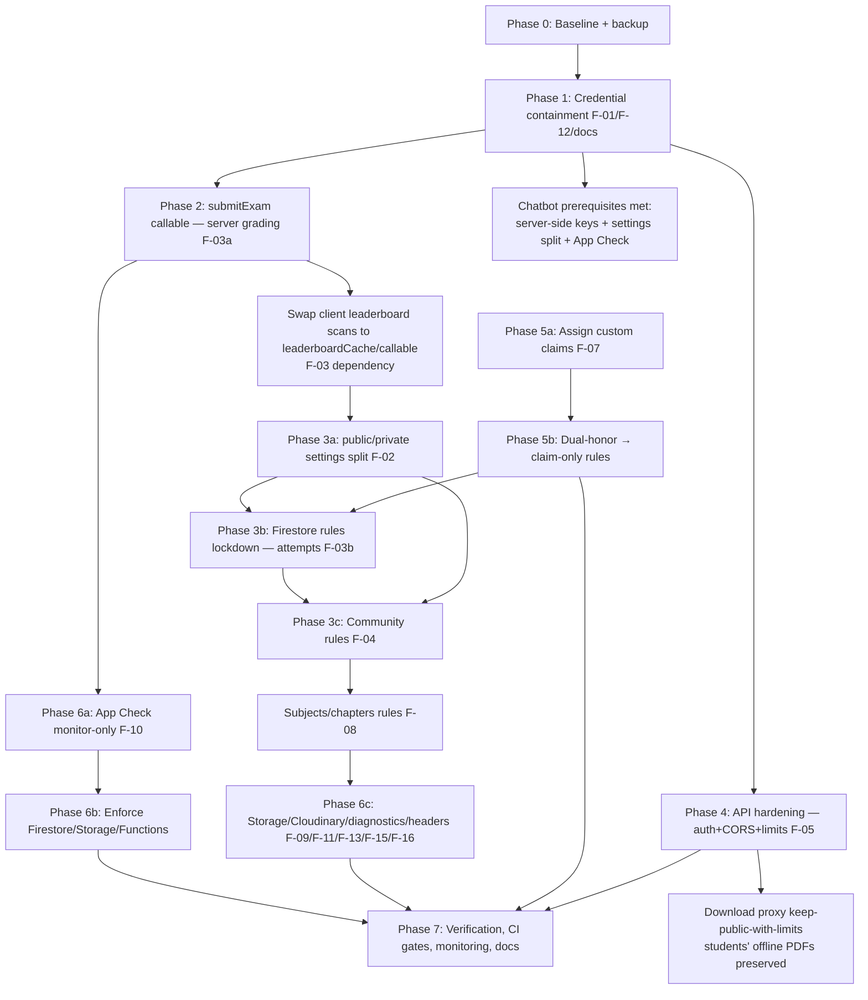

# EthioSmart — Security Remediation Plan

**Date:** 2026-11-14 · **Type:** Planning-only deliverable · **Scope:** Inspection + remediation design (nothing was fixed, deployed, or modified)
**Project:** EthioSmart (a.k.a. ExamPro) — Ethiopian freshman exam-prep platform · Live: https://ethiosmart.vercel.app/ · Local: `/home/usama/Downloads/ethiosmart-main`
**Related document:** `ETHIOSMART_IMPROVEMENT_PLAN.md` (product/architecture plan, chatbot scope). The chatbot is **out of scope here**; §K lists the security prerequisites it depends on.

> **Reading rules:** VERIFIED = confirmed in this repository today with the cited path/line. POTENTIAL = needs production/console verification. RECOMMENDATION = proposed, not yet approved. No credential values appear anywhere in this document (keys are referenced only by file + purpose, or by irreversible hash prefixes marked `[sha…]` used solely to prove two strings are the same credential across files).

---

## A. Executive Summary

### A.1 Overall assessment
EthioSmart has a **working but unsafely-default** posture: Firebase rules are the only server-side authorization for most data, and they are wide open on the collections that matter most (attempts, community, settings). AI provider credentials are committed in source code and in documentation, and are shipped to the browser. Exam grading is client-side, so scores are forgeable by any client. Administrative identity is a hardcoded email string instead of verified claims. None of this is theoretical — every one of these paths was read and traced in this repository.

The good news: the failure modes are conventional, the blast radius is bounded (no payment data, no ID documents), and safe staged remediation is feasible without taking the product down. The `functions/src/ai-generator` module also shows the team already knows the correct server-side pattern (secrets + admin verification + input validation) — remediation consists largely of applying it uniformly.

### A.2 Most serious confirmed findings (top 5)
1. **F-01 — Exposed AI provider credentials** in frontend-accessible source (`src/lib/ai-settings.ts`), in Vercel API fallbacks (`api/ai/*`), and **additional Google AI keys committed in 5 markdown docs** (`API_KEY.md`, `AI_IMPROVEMENTS.md`, `AI_MCQ_GENERATION_GUIDE.md`, `API_KEY_INPUT_FEATURE.md`, `VERCEL_ENV_SETUP.md`). Rotation required by the owner.
2. **F-03 — `examAttempts` + `answers` are world-readable and world-writable** (`firestore.rules:93–104`) **and** grading is computed in the browser (`TakeExam.tsx`, `src/lib/firebase-attempts.ts`) → any anonymous client can read every student's results and forge any score.
3. **F-02 — `settings` collection is world-readable** (`firestore.rules:31–34`) → `settings/ai_providers` exposes the AI keys to anyone; also leaks system configuration.
4. **F-04 — Community chat fully unauthenticated** (`firestore.rules:215–236`, wildcard `{allChildren=**}`) → anonymous read/write/delete of all channels/messages, including "Official Announcements" (client-side-only gate).
5. **F-12 / F-05 — Public abuse surface**: `signIn()` auto-provisions accounts for emails matching test patterns; `/api/ai/provider-status` accepts API keys as URL query parameters and is called anonymously; `/api/drive/download` relays arbitrary public Drive files with no auth, size cap, or rate limit.

### A.3 Immediate owner actions (before any implementation)
1. **Rotate now**: the 4 built-in AI provider keys (Gemini/Groq/OpenRouter/HuggingFace, present in `src/lib/ai-settings.ts` and `api/ai/*`) and the additional Google AI keys embedded in the 5 docs above (one key is repeated across `API_KEY.md`, `AI_IMPROVEMENTS.md`, `VERCEL_ENV_SETUP.md`). Treat every matching value in git history as compromised even after code removal.
2. Check provider dashboards (Google AI Studio / Groq / OpenRouter / HF) for anomalous usage.
3. Verify in Firebase Console that deployed Firestore rules match `firestore.rules` in this repo (rules may drift from repo).
4. Take a Firestore backup export before any rules/data work.
5. Confirm Firebase Blaze plan + App Check site keys are available.

### A.4 Main implementation risks
- Locking `examAttempts` before server-side grading exists → students cannot submit; offline sync breaks; leaderboard triggers misbehave.
- Restricting `settings` reads without a public/private split → breaks client cold-start (login mode, default department, community mode all read `settings/system_settings` and `settings/communityChat` anonymously).
- Custom-claims rules without pre-assigned claims → everyone locked out (including the owner).
- App Check enforcement without testing all clients (web/PWA/Capacitor Android) → legitimate users blocked.
- API authentication without preserving student workflows (`/api/drive/download` is used by students for offline PDFs) → offline library broken.
- Rules tested only in emulator, deployed blind to production → undetected breakage; every rules change needs staged rollout + monitoring.

---

## B. Verified Findings

| ID | Finding | Status | Severity | Affected Files (key) | Required Action |
|---|---|---|---|---|---|
| F-01 | Exposed AI provider credentials (code + docs + API fallbacks) | Confirmed | **Critical** | `src/lib/ai-settings.ts` (BUILTIN_DEFAULT_KEYS ~L40–45), `api/ai/generate-batch.ts` L35–38, `api/ai/provider-status.ts` L5–8 & L40–46, `src/lib/ai-generator-service.ts` L60–220, `API_KEY.md`, `AI_IMPROVEMENTS.md`, `AI_MCQ_GENERATION_GUIDE.md`, `API_KEY_INPUT_FEATURE.md`, `VERCEL_ENV_SETUP.md` | Owner rotates all keys; purge code/docs; server-only secrets |
| F-02 | `settings` Firestore collection world-readable (AI keys + config) | Confirmed | **Critical** | `firestore.rules:31–34`; readers: `src/lib/system-settings.ts` L113/273, `src/lib/community.ts` L255/282/312, `src/lib/ai-settings.ts` L194/319 | Split public vs private docs; keys out of Firestore |
| F-03 | `examAttempts`/`answers` world read/write + client-side grading | Confirmed | **Critical** | `firestore.rules:93–104`; `src/lib/firebase-attempts.ts` (submitAttempt ~L207, calculateScoreFromAnswers L220); `src/pages/TakeExam.tsx` (submitExam ~L608–696) | Server-side `submitExam` function; then lock rules |
| F-04 | Community collections fully open (incl. wildcard + announcements) | Confirmed | **Critical** | `firestore.rules:215–236`; `src/lib/community.ts` (send/pin/delete/purge); `src/pages/CommunityChat.tsx:649` (client-only gate) | Auth + ownership validation rules; drop wildcard |
| F-05 | Vercel API: unauthenticated, CORS `*`, keys in GET query, no size/rate limits | Confirmed | **High** | `api/ai/generate-batch.ts`, `api/ai/provider-status.ts`, `api/drive/validate.ts`, `api/drive/download.ts`, `api/drive/extract-content.ts` | Auth for admin endpoints; harden public download proxy |
| F-06 | Shared guest account with hardcoded password | Confirmed | **High** | `src/lib/guest-session.ts:10–14`; `src/components/auth/GuestSetupDialog.tsx`; `src/contexts/AuthContext.tsx` | Constrain guest capabilities; evaluate Anonymous Auth |
| F-07 | Hardcoded superadmin identity in client, functions-adjacent code, rules | Confirmed | **High** | `src/types/permissions.ts:265` (SUPER_ADMIN_EMAIL), `src/lib/permission-middleware.ts` (4 refs), `src/lib/firebase-admin-protected.ts` (2), `src/hooks/useGranularPermissions.ts` (2), `src/lib/firebase-admin.ts:570`, `src/pages/AdminGradeExam.tsx:58`, `firestore.rules:27` | Migrate to custom claims; remove literals |
| F-08 | Subjects/chapters writable by any authenticated user | Confirmed | **High** | `firestore.rules:112–121`; writers: `src/lib/subjects.ts`, `src/components/subject/*` | Admin/examiner-only writes + tests |
| F-09 | Storage: `exam-images`, `subject-covers` writable by any authenticated user | Confirmed | **Medium** | `storage.rules` (covers read public); `src/lib/image-upload.ts` (subject-covers/, question-images/ paths) | Admin-only writes; per-user/exam paths; keep 5MB+image MIME |
| F-10 | App Check never enforced (init optional, no server verification) | Confirmed | **Medium** | `src/integrations/firebase/client.ts` (conditional init), no `enforceAppCheck` anywhere (repo grep), `.env.example` missing key | Staged rollout; enforce on Functions/Firestore/Storage |
| F-11 | Diagnostic/setup pages shipped unguarded | Confirmed | **Medium** | `src/App.tsx:125–127` (`/firebase-test`, `/firebase-diagnostic` unguarded; `/admin-setup` public), diagnostics print config/client env | Remove or restrict (admin/dev-only) |
| F-12 | `signIn()` auto-provisions accounts on email pattern match | Confirmed | **Medium** | `src/lib/auth.ts` (signIn catch-block auto-create); role escalation attempt blocked today by `users` create rules (role must be `student`) | Delete auto-provision; seeded E2E accounts |
| F-13 | Security-related config exposure (docs keys, no headers, strict TS off, verbose logging) | Confirmed | **Medium** | `docs/openapi.yaml` + `.kiro/specs/*/design.md` (Firebase web key, public by design), docs with AI keys (see F-01), `vercel.json`/`firebase.json` (no `headers`), `tsconfig.app.json` (`strict:false`), `eslint.config.js` (`no-unused-vars` off), `src/lib/auth.ts` (logs email/name), `src/lib/client.test.ts` + `src/integrations/firebase/client.ts` (web key, public by design), `SYSTEM_OVERVIEW.md` (truncated key prefixes) | Scrub; headers; strict mode path; log hygiene |
| F-14 | Cloud Functions runtime Node 18 (deprecated; 14/16 decommissioned 2025) | Confirmed | **Low–Medium** | `functions/package.json` (`"node": "18"`), lock: firebase-functions 5.1.1, firebase-admin 12.7.0 | Plan Node 20 (or 22) after emulator test; not in this task |
| F-15 | `question-images/` path has no Storage rule → question-image Firebase fallback always denied → app stores base64 data URIs into Firestore | Confirmed | **Medium** | `storage.rules` (no match), `src/lib/image-upload.ts` (`question-images/` writer + local data-URI fallback ~L600–700) | Add `question-images` rule; cap data-URI size; fix fallback order |
| F-16 | Cloudinary unsigned upload preset used client-side (anyone can push arbitrary files to the account) | Confirmed | **Medium** | `src/lib/image-upload.ts` (unsigned preset flow, Tier 1), `.env.example` (`VITE_CLOUDINARY_UPLOAD_PRESET=exampro_unsigned`) | Signed preset or server-side upload; moderation add-on |

**Tally: 16 findings — 16 Confirmed · 0 Partially confirmed · 0 Not reproducible · 0 require external verification to confirm the source code behavior.** Several *impact* conclusions (e.g., key abuse in the wild, production rule drift) are explicitly marked POTENTIAL/requires-external-verification below and in §J.

### B.1 Verified non-issues (so they are not re-litigated)
- Firebase **web** API key in client code is public by design (not a leak); the problem is its **hardcoded fallback** in `client.ts` (config drift masks misconfiguration), and web keys in docs being redundant noise.
- `functions/` AI path uses proper secrets (`runWith({ secrets: [...] })`), admin verification, input validation — correct pattern (`functions/src/ai-generator/index.ts`).
- `avatars/{uid}/…` path-per-owner write rule is correct.
- `/admin-setup` page grants no privileges (informational only, by design).
- `AdminGradeExam` client-side `canDeleteResults` is UX; real enforcement must come from rules/functions (covered by F-03).

---

## C. Detailed Finding Analysis

### F-01 — Exposed AI provider credentials — **Critical · Confirmed**
**Evidence**
- `src/lib/ai-settings.ts`: `BUILTIN_DEFAULT_KEYS` object (~L40–45) contains full-length Gemini, Groq, OpenRouter, HuggingFace keys used when no other key is configured; `DEFAULT_AI_SETTINGS` enables all four providers by default (L34–40, 49–112). `getPreconfiguredEnvKeys()` (L40–77) merges env → localStorage → built-in, so keys reach every browser bundle (`vite.config.ts` only uses them client-side; they are *not* `import.meta.env`-guarded).
- `api/ai/generate-batch.ts` L35–38 and `api/ai/provider-status.ts` L5–8: identical `BUILTIN_KEYS` fallbacks; `loadEnvKeys()` prefers `process.env.*` then falls back to the built-ins (so the server never fails closed — a missing env var silently ships the burned keys again).
- `api/ai/provider-status.ts` L40–46: reads client keys from `req.query.keys` (JSON) — API keys arrive via **GET URL** (logs of every proxy/CDN hop, browser history).
- `src/lib/ai-generator-service.ts` L95–113: client sends **all effective keys** (`settingsKeys` → `meta.VITE_*` → `localStorage` → `BUILTIN_DEFAULT_KEYS`) to `/api/ai/provider-status?keys=…` (L108), and the full provider key set in the `POST /api/ai/generate-batch` body (`requestWithSettings.providerKeys`, L170–186) — including built-in keys the admin never typed.
- Docs: `API_KEY.md` is literally labeled "Current Active API Key" (a full-length Google AI key); `AI_IMPROVEMENTS.md` (2 occurrences), `API_KEY.md` and `VERCEL_ENV_SETUP.md` share one repeated Google AI key (consistent across files — same credential); `AI_MCQ_GENERATION_GUIDE.md` contains a second distinct Google AI key (4 occurrences); `API_KEY_INPUT_FEATURE.md` contains a third distinct Google AI key (2 occurrences). `docs/openapi.yaml` and `.kiro/specs/supabase-to-firebase-migration/design.md` contain the Firebase **web** key only (public by design — informational).
**Attack scenario** — Any visitor extracts the client bundle (or opens the docs), harvests keys, and runs up provider bills or resends traffic; the keys are also in git history forever.
**Impact** — Financial (AI billing), service availability (quota exhaustion), reputational. No direct PII loss. Keys must be considered public.
**Publicly exploitable?** — Yes, anonymously, from any browser.
**Recommended solution**
1. **Owner:** rotate the 4 built-in provider keys **and** the ≥3 distinct Google AI keys found in docs (Google AI Studio ×3–4, Groq console, OpenRouter, HF). Invalidate old keys everywhere.
2. Remove `BUILTIN_DEFAULT_KEYS`/`BUILTIN_KEYS` entirely; fail closed when no server-side key configured.
3. Server-side secrets: Vercel → Environment Variables (`GEMINI_API_KEY`, etc., **no `VITE_` prefix**); Firebase Functions → `runWith({ secrets: [...] })` pattern already proven in `functions/src/ai-generator/index.ts` (or `defineSecret`). Client never sees keys; the Firestore `settings/ai_providers` doc stores **booleans/masks only** (or nothing).
4. Rewrite `provider-status`: POST with Firebase ID token (admin-only), returns `configured|missing|cooldown` booleans; no keys in URLs; response contains no key material. Rewrite `generate-batch` similarly (admin token required).
5. Scrub docs: delete `API_KEY.md`, redact keys in the other docs, rewrite `VERCEL_ENV_SETUP.md` with placeholders. Purge git history (BFG/filter-repo) or accept keys as compromised (rotation makes history harmless).
6. Add `gitleaks`/secret scanning to CI (see §E Phase 7).
**Files likely to change:** `src/lib/ai-settings.ts`, `src/lib/ai-generator-service.ts`, `api/ai/*`, `src/components/admin/AIProviderSettingsSection.tsx` (key input stays, but status via new endpoint), `.env.example` (document server env vars), docs cleanup.
**Required tests:** unit test that `getAISettings()` never returns built-in keys when none configured; integration test that `/api/ai/*` returns 401 without token, 403 for non-admin; grep-based CI gate (`AIza`, `gsk_`, `sk-or-`, `hf_`, `Bearer` patterns → fail).
**External dependencies:** Vercel project env config; Google AI Studio/Groq/OpenRouter/HF consoles; Firebase secrets; owner's approval to invalidate keys.
**Compatibility risks:** Admin AI question generation temporarily fails until new env keys are set (acceptable; coordinate). `getAIProviderStatuses()` UI must degrade gracefully to "not configured".

### F-02 — `settings` world-readable; public/private mixed — **Critical · Confirmed**
**Evidence** — `firestore.rules:31–34` (`allow read: if true`); three docs under `settings/`:
- `settings/ai_providers` — **secrets** (API keys) read/written by `src/lib/ai-settings.ts` L194/319 (admin AI settings screens; UI-gated but not rule-gated).
- `settings/system_settings` — non-secret but admin-controlled (`requireStudentLogin`, `defaultDepartmentId/Name`, `practiceExamsEnabled`, `defaultPassingScore`, …) read anonymously by `src/lib/system-settings.ts` (cold-start with localStorage cache; L113, L273) — needed by *all* visitors including logged-out.
- `settings/communityChat` — single field `mode` (`stored|live`) read anonymously by every chatclient incl. anonymous users via `onSnapshot` (`src/lib/community.ts` L255/270–282/312).
**Attack scenario** — Anonymous `GET https://firestore.googleapis.com/v1/projects/online-exam-f443c/databases/(default)/documents/settings/ai_providers` returns all provider keys.
**Impact** — Credential disclosure (see F-01), configuration tampering visibility (write still admin-only), information leakage of operational config.
**Publicly exploitable?** — Yes.
**Recommended solution** (do **not** simply deny `settings` reads — breaks the app):
1. **Split into public vs private documents** (minimal-change approach):
   - Create `publicSettings/app` (world-readable via rules): `{ requireStudentLogin, defaultDepartmentId, defaultDepartmentName, practiceExamsEnabled, communityChatMode }` — everything the cold-start path needs and nothing else.
   - Move `ai_providers` **out of Firestore entirely** (server-side secrets only, F-01). If provider "configured/enabled/model" metadata must persist for admin UI, keep a `settings/ai_providers` doc with **no key material** and make it **admin-only read**.
   - Keep `settings/communityChat` → fold its single `mode` field into `publicSettings/app` (or keep doc but move rules).
2. Client changes: `system-settings.ts` reads `publicSettings/app` (fallback chain preserved: localStorage → Firestore → hardcoded defaults); `community.ts` reads `publicSettings/app.communityChatMode`; `ai-settings.ts` reads admin-only doc (rules-enforced), shows masked "configured" booleans.
3. Rules after split: `match /publicSettings/{doc} { allow read: if true; allow write: if isAdminOrSuper(); }` and `match /settings/{id} { allow read: if isAdminOrSuper(); allow write: if isAdminOrSuper(); }`.
4. Migration: one-time Admin-SDK script copies `system_settings` + `communityChat.mode` into `publicSettings/app` (dry-run log first; keep old docs readable for rollback for 30 days, then delete via owner-run script).
**Files likely to change:** `firestore.rules`, `src/lib/system-settings.ts`, `src/lib/community.ts`, `src/lib/ai-settings.ts`, `scripts/migrate-public-settings.ts` (new, owner-run), `firestore.indexes.json` (none), tests for all three readers.
**Required tests:** emulator test: anonymous client can read `publicSettings/app`; anonymous **cannot** read `settings/ai_providers`; `system-settings` cold-start works with rules enforced; community mode toggle still works; existing-install localStorage cache unaffected.
**External dependencies:** production data write (one-off), console access optional.
**Compatibility risks:** Cold-start race — client must handle `publicSettings` missing (defaults already implemented); old clients (pre-deploy PWA cache) keep reading `settings/system_settings` — **keep `settings/system_settings` readable temporarily** (or accept breakage window for offline-cached PWAs; flag for owner).

### F-03 — `examAttempts` open + client-side grading — **Critical · Confirmed**
**Evidence** — `firestore.rules:93–104` (`read/create/update: if true`, answers likewise). Client computes score: `TakeExam.tsx` ~L640–650 (`selectedOption === q.correctOptionIndex` loop in `submitExam`) and again in `src/lib/firebase-attempts.ts` `calculateScoreFromAnswers` (L220–235, honors `manualGrade`) → `submitAttempt()` (L207–216) `updateDoc(examAttempts/{id}, { isSubmitted, submittedAt, totalScore, maxScore, timeSpentSeconds })`. Also `saveAnswer` (setDoc merge, L190–198) and `createAttempt` (addDoc, L45). Server side: `functions/src/leaderboard.ts` triggers `onExamAttemptUpdate` (admin SDK — bypasses rules, still works). Readers: `StudentResults`/`ExamResults` (own), `AdminGradeExam`, `AdminAllResults`, `practice-exam-results.ts` L80, `admin-practice-analytics.ts` L51, **`firebase-leaderboard.ts` L197/534 and `simple-leaderboard.ts` L55–110 — cross-student full-scan reads that only work because `read: if true`**.
**Attack scenario** — `curl` the REST endpoint to list all `examAttempts` (every student's scores/emails in `examAttempts.studentEmail/Name`), or `updateDoc` any attempt to a perfect score; leaderboards (`leaderboardCache`) then amplify it.
**Impact** — Mass grading fraud, privacy violation (student names/emails/scores exposed unauthenticated), leaderboard integrity destroyed.
**Publicly exploitable?** — Yes, anonymously.
**Recommended solution (staged — do NOT flip rules before server grading exists)**
1. **Build `submitExam` callable** (`functions/src/attempts.ts` or in `ai-generator`-style module): input `{ attemptId }`; server loads attempt + exam questions from Firestore; recomputes `totalScore` from answers (MCQ/TF auto; written answers keep `manualGrade`/`isCorrect` null → admin grading flow unchanged); validates: attempt belongs to caller (or caller is admin), not already submitted (or allow resubmit policy as today), time-window sanity check (warn, not block), maxScore from questions; writes atomically (batch) `isSubmitted/submittedAt/totalScore/maxScore/timeSpentSeconds`; returns result. Keep `createAttempt` + per-answer writes **client-side temporarily** (rules: own-attempt create, own-answer create/update while attempt `isSubmitted == false`).
2. Client: `TakeExam.tsx` calls `httpsCallable('submitExam', { attemptId })` instead of computing score locally; remove client score math (or keep for offline practice review only — practice mode is 100% offline and never touches Firestore, VERIFIED: `submitPracticeExam` uses IndexedDB only).
3. Offline normal exams: queue submission; on reconnect call `submitExam`; server validates answers against stored attempt (offline answers are also synced client-side today — acceptable interim: validate shape + ownership server-side).
4. **Then** lock rules: `read`: owner (`studentId == request.auth.uid`) or admin/superadmin; `create`: authenticated + `request.resource.data.studentId == request.auth.uid` + `isSubmitted == false` + required-keys validation; `update`: **only via Admin SDK** (`if false` for clients); answers: read owner/admin, create/update owner only while attempt unsubmitted, shape-validated.
5. Replace client leaderboard full-scan fallback (`simple-leaderboard.ts` L55–110, `firebase-leaderboard.ts` L197–230) with **`leaderboardCache`/`leaderboardRankings` reads** (rules already allow authenticated read) or callables (`calculateDepartmentLeaderboard`) — otherwise students lose their dashboard leaderboard and admin analytics breaks (`practice-exam-results.ts`, `admin-practice-analytics.ts` need admin-claims — already admin routes, fine under new rules).
6. Leaderboard spam: note forged scores become impossible post-fix; historical forged scores unverifiable (no audit) — flag for owner; optional one-time sanity script to flag impossible scores (e.g., `totalScore > sum(marks)`).
**Files likely to change:** new `functions/src/attempts.ts` (+export), `src/pages/TakeExam.tsx`, `src/lib/firebase-attempts.ts` (remove score math), `src/lib/simple-leaderboard.ts`, `src/lib/firebase-leaderboard.ts`, `src/lib/firebase-leaderboard-admin(-protected).ts`, `firestore.rules`, emulator tests.
**Required tests:** emulator suite — student cannot read others' attempts; cannot update score; can create own attempt; callable recomputes correct score (MCQ/TF); manual grading flow (`saveAnswerGrade`) unaffected; offline-then-online submit works; StudentDashboard leaderboard renders from cache; admin analytics unchanged.
**External dependencies:** Functions deploy (owner approval), Blaze plan, rules deploy (owner approval).
**Compatibility risks:** Any third-party/E2E writing attempts via rules will break (none present per grep); offline PWA with old JS cached — serve with version bump/cache-bust (vite build hash handles); resubmit policy must be preserved (attempts today: multiple attempts allowed per `maxAttempts` logic in `TakeExam.tsx` L200ish — server must honor `exam.maxAttempts`).

### F-04 — Community open; wildcard; announcements client-gated — **Critical · Confirmed**
**Evidence** — `firestore.rules:215–236`: `communityChannels` read/write `true`; `messages` create/update/delete `true`; nested wildcard `allow read, write: if true` on `{allChildren=**}`; `communityMessages` (legacy collection) read/write `true`. Client flows (`src/lib/community.ts`): `sendCommunityMessage` (addDoc — any channel id incl. `announcements`), `pinCommunityMessage` (any user pins/unpins **any** message), `deleteCommunityMessage` (soft-delete others' messages), `purgeLiveChannelMessages` (batch-delete others' messages), `toggleReaction` (rewrite reactions). Announcements gate is UI-only: `CommunityChat.tsx:649` blocks students posting to `announcements` in the UI, but the SDK writes are unrestricted by rules. Also `userRole` in messages is **client-asserted** (`CommunityChat.tsx` L433/457) — a forged `userRole: 'admin'` badge renders as admin to all viewers.
**Attack scenario** — Anonymous script: wipe all channels/messages; post as "admin" with fake badge; pin spam; purge "live" messages; scrape all chats (they may contain student emails — `userEmail` field stored in every message, VERIFIED in `sendCommunityMessage`).
**Impact** — Anonymity catastrophe, impersonation, harassment, data destruction, privacy leak (emails).
**Publicly exploitable?** — Yes.
**Recommended solution** — Rules with **ownership + role validation**:
```
match /communityChannels/{channelId} {
  allow read: if true;  // channel list is non-sensitive (name/desc/category only) — keep public or require auth (decide)
  allow create/update/delete: if isAdminOrSuper();
  match /messages/{messageId} {
    allow read: if true;                       // public-read chat (product decision; else isAuthenticated())
    allow create: if isAuthenticated()
      && request.resource.data.userId == request.auth.uid
      && request.resource.data.userRole in ['student','admin','superadmin']
      && (channelId != 'announcements' || isAdminOrSuper() || isExaminer());
    allow update: if (isAuthenticated() && resource.data.userId == request.auth.uid && only(['text','imageUrl','reactions','deleted','updatedAt']).affectedKeys())
                  || isAdminOrSuper();
    allow delete: if isAuthenticated() && resource.data.userId == request.auth.uid || isAdminOrSuper();  // admin moderation
  }
}
```
- Drop `{allChildren=**}` and `communityMessages` entirely (verify no live reads first — `src/lib/community.ts` reads only `communityChannels/…/messages` and `settings/communityChat` — VERIFIED; `communityMessages` appears unused in src → safe to remove rules block, keep data).
- Pin/unpin/announcements: restrict to admin/examiner claims; reactions: any authenticated on others' messages but only their own `userId` entries — enforce via rules diff on `reactions` (complex; acceptable: allow update limited to `reactions` key with array-contains checks on own uid, or route through callable `toggleReaction` — simpler & robust).
- Client: send `userRole` from profile (server-verifiable via custom claims — see F-07), not from client constant; keep soft-delete UX.
- Email in messages: stop writing `userEmail` into messages (store avatar/name only) — privacy-by-design; keep field for backward compat on read.
**Files likely to change:** `firestore.rules`, `src/lib/community.ts`, `src/pages/CommunityChat.tsx` (role from claims; announcement UI stays), `src/types/community.ts` (optional userEmail removal), emulator tests.
**Required tests:** emulator — anonymous cannot create/update/delete; student can post to `general` + own `dept_*`, cannot post to `announcements`; student cannot pin/delete others; admin can moderate; forged `userRole` rejected (rules check claim, not payload); live-purge only by author/admin.
**External dependencies:** rules deploy (owner).
**Compatibility risks:** Old cached PWAs (write attempts as anonymous) will fail with visible errors — acceptable; show friendly error in `CommunityChat` (already handles `onError` toast).

### F-05 — Vercel API endpoints unauthenticated, CORS `*`, keys in URL, no caps — **High · Confirmed**
**Endpoint inventory & callers**
| Endpoint | Purpose | Caller (frontend) | Today | Abuse |
|---|---|---|---|---|
| `GET /api/ai/provider-status` | Check which AI providers configured | `AdminAIGenerator.tsx:276` (admin-only page) via `src/lib/ai-generator-service.ts:108` (**sends all effective keys as GET query param**) | No auth; keys in URL; returns booleans | Free key-validation oracle for anyone's keys; keys leak into logs; built-in keys used |
| `POST /api/ai/generate-batch` | Batch-generate exam questions | `AdminAIGenerator.tsx` (admin-only) via `ai-generator-service.ts:170`; also `src/server/ai-bridge.ts` dev middleware | No auth; body carries full key set; falls back to built-ins | Free AI generation gateway; 50×n questions per call; provider-bill abuse |
| `GET /api/drive/download?fileId=` | Relay public Google Drive file (PDF) | Students: `BookReader.tsx:182`, `MobileVerticalReader.tsx:620/731`, `offline-books.ts:211`; admins: `AdminShortnotesStudio.tsx`, `AdminAIGenerator.tsx` | No auth; whole file buffered in memory; **no size cap**; `Cache-Control: public, max-age=86400` | Unmetered bandwidth proxy; memory exhaustion (large Drive file); edge-cache poisoning of private-link files |
| `POST /api/drive/validate` | Validate public Drive file id before import | Admins via `BookFormDialog.tsx:281` → `google-drive.ts:107` | No auth | Drive metadata oracle (filename of any "anyone-with-link" file) |
| `POST /api/drive/extract-content` | Extract text/PDF preview for AI import | Admins via `AdminAIGenerator.tsx:455`, `AdminShortnotesStudio.tsx:581` | No auth; body ≤1MB cap OK | Content extraction oracle for public Drive files |

**Evidence of caller→endpoint binding** — grep verified (paths above); no other callers found; `docs/openapi.yaml` documents both groups as public endpoints.
**Recommended solution**
1. **Admin endpoints** (`ai/generate-batch`, `ai/provider-status`, `drive/validate`, `drive/extract-content`): verify Firebase **ID token** (`Authorization: Bearer`) with `firebase-admin` (new dependency for Vercel function or reuse `functions/` to avoid new dep), require admin custom claim (F-07) — **or simpler: fold all four into callable Functions** and delete the Vercel duplicates (the repo already duplicates server logic in `src/server/*` vs `api/*` vs `functions/` — consolidate, don't multiply). Fail closed if env keys missing.
2. **`GET /api/ai/provider-status` → POST**, no keys in URL; keys stay server-side; response = booleans only.
3. **Public `GET /api/drive/download`** — keep anonymous for students but make it safe: (a) require `fileId` regex `^[A-Za-z0-9_-]{20,60}$`; (b) **size cap** (e.g., 25 MB — stream or reject via HEAD/content-length); (c) **rate limit** (per-IP, e.g., 60/hour; Vercel edge config or token-bucket in Firestore); (d) keep `s-maxage` but drop `public` cache poisoning by not caching 200s with attacker-controlled fileIds — set `private, max-age=3600` or key the edge cache; (e) CORS `*` → restrict to `https://ethiosmart.vercel.app` + localhost (dev). Alternative: replace proxy with direct browser download (works for `uc?export=download` via top-level navigation, not fetch) — bigger UX change; keep proxy with the limits above.
4. CORS: all endpoints → allowlist; credentials: none; preflight tighten.
5. Rate limit `generate-batch` per uid (e.g., 20 batches/day) — it is admin-only; still bound cost.
**Files likely to change:** `api/ai/*`, `api/drive/*` (or delete + port to `functions/`), `src/lib/ai-generator-service.ts`, `src/lib/google-drive.ts`, `vercel.json` (headers), `.env.example`.
**Required tests:** emulator/integration: 401 without token; 403 student token; 200 admin token; oversize file → 413; rate-limit → 429; CORS preflight denied for unknown origin.
**External dependencies:** Vercel env (token verify needs `FIREBASE_SERVICE_ACCOUNT` or firebase-admin default; or port into Functions where Admin SDK is already available), owner deployment approval.
**Compatibility risks:** Student offline PDF flow depends on the download proxy — **keep it public with limits** (do not add auth; offline PWAs may lack fresh tokens); validate no other consumers of `/api/drive/validate` (students don't call it — VERIFIED).

### F-06 — Shared guest credentials — **High · Confirmed**
**Evidence** — `src/lib/guest-session.ts:10–14`: `GUEST_AUTH_EMAIL` / `GUEST_AUTH_PASSWORD` literals in shipped bundle; guests authenticate via `signInWithEmailAndPassword` (shared identity) in `AuthContext.tsx` (~L290–310); guest profile in localStorage (`GUEST_PROFILE_STORAGE_KEY`); `updateGuestProfile` lets guest pick name + **department** (`GuestSetupDialog`); device id client-generated (`guest_<uuid>`). Guest capability is **not** differentiated in rules anywhere — a guest is a signed-in user: can currently create attempts, write chat (once fixed to authenticated), vote reactions, download books.
**Attack scenario** — Not privilege escalation; rather: anonymous-at-scale write access if any future rule assumes "signed in ⇒ real student"; shared identity destroys auditability (all guests = one `users/{uid}` doc); password can't be secret (it's public) so the account will accumulate abuse flags over time; email enumeration not needed.
**Recommended solution**
1. **Near-term (keep experience)**: keep shared guest for open-access mode, but (a) treat guests in rules as least-privilege: may read published content, create **own** attempts + answers, post chat **with** `userRole='student'` + rate-limited, **no** access to `archivedResults` of others (already), no admin-anything (already via claims); (b) server-side cap: callable `submitExam` ignores guest `totalScore` unless… no — guests legitimately take exams; keep same rules as students but with **stricter rate limits**; (c) disable password-based guest sign-in optionality — it's the only mode; keep.
2. **Mid-term (recommended Phase 5+)**: replace with **Firebase Anonymous Authentication** → per-device uid, optional name attach, no shared identity, rules treat `request.auth.token.firebase.sign_in_provider === 'anonymous'` → same least-privilege tier. Requires: Auth console enable anonymous provider; client change (`signInAnonymously()` in guest path); migrate guest profiles (map old shared-uid data to per-device anonymous uid? Data created under shared uid can't be re-owned — acceptable; attempts survive in Firestore keyed by old uid, visible as guest). Preserves experience: tap "Continue as guest" → instant session, no credentials.
3. Document in admin UI: open-access mode risk (guest spam surface) — toggle already exists (`requireStudentLogin`); recommend default ON.
**Files likely to change:** `src/lib/guest-session.ts`, `src/contexts/AuthContext.tsx`, `GuestSetupDialog.tsx`, `firestore.rules` (guest tier), `src/components/auth/ProtectedRoute.tsx`.
**Required tests:** guest CAN take exam & chat; guest CANNOT read others' attempts; guest rate limit triggers after N messages; guest upgrade path (anonymous → permanent account) links profile optionally (future).
**Compatibility risks:** Anonymous users counted in Firebase Auth metrics; rules `isAuthenticated()` remains true for guests — all "authenticated" grants apply; audit must log guest uids (fine).
**Product decision needed:** keep shared guest (simplest) vs anonymous auth (safer) — owner call; see §J.

### F-07 — Hardcoded superadmin identity — **High · Confirmed**
**Evidence** — Literal identity in: `src/types/permissions.ts:265` (`SUPER_ADMIN_EMAIL`), `src/lib/permission-middleware.ts` (4 usages — bypass of permission checks), `src/lib/firebase-admin-protected.ts` (2 usages — admin-protected callables), `src/lib/firebase-admin.ts:570` (`isSuperAdmin(email)`), `src/hooks/useGranularPermissions.ts` (2), `src/pages/AdminGradeExam.tsx:58`; plus `firestore.rules:27` (`isAdminOrSuper()` grants full admin for that email at **rules level**). Functions correctly use claims-or-Firestore role (`functions/src/leaderboard.ts`, `functions/src/ai-generator/index.ts:31–49` — checks `token.role`/`token.admin` then Firestore `users.role`) — the correct pattern already exists in the repo.
**Attack scenario** — Anyone who registers/controls that mailbox (or finds it leaked — it is in the repo) inherits silent super-admin at rules level regardless of their `users/{uid}.role`; client checks can't be trusted anyway (UX-only), so this is the one path that **must** move server-side.
**Recommended solution**
1. Set custom claim `role: 'superadmin'` (and `'admin'`/`'examiner'` as applicable) via Admin SDK one-time script (`scripts/set-admin-claims.ts`, owner-run with service account) for the legitimate owner account(s).
2. `firestore.rules`: `isAdminOrSuper()` → `isAuthenticated() && request.auth.token.role in ['admin','superadmin']` (drop email clause); keep `isSuperAdmin()` claim-based.
3. Client: `permission-middleware`, `useGranularPermissions`, `AdminGradeExam`, `firebase-admin(-protected)` → read role from **claims** (`getIdTokenResult()`) with Firestore `users.role` fallback during transition window (dual-honor period, then remove fallback).
4. Firestore `users` doc remains the display/role source for UI; claims remain authorization source for rules/functions. Rules may also read `users/{uid}.role` (as functions do) — but claims are cheaper and revocation-friendly via `revokeRefreshTokens`.
5. Avoid lockout: dual-honor phase (claim OR (email == owner) OR users.role=='admin') for one release, then strict claim-only. Keep a documented recovery procedure (re-run claims script with service account from Google Cloud shell).
**Files likely to change:** `src/types/permissions.ts`, `src/lib/permission-middleware.ts`, `src/hooks/useGranularPermissions.ts`, `src/lib/firebase-admin.ts`, `src/lib/firebase-admin-protected.ts`, `src/pages/AdminGradeExam.tsx`, `src/contexts/PermissionsContext.tsx`, `firestore.rules`, new `scripts/set-admin-claims.ts`.
**Required tests:** claims set → owner retains super-admin in UI + rules emulator test with claim token; account without claim loses access; token refresh after claim set (force re-auth or `getIdToken(true)`); non-owner admin (role=admin claim) still works.
**External dependencies:** service account key for claims script (or `firebase functions:shell`), owner approval; **do not print or commit the service account JSON**.
**Compatibility risks:** Tokens issued before claim assignment lack claims until refresh (≤1h) — dual-honor window mitigates; Admin SDK script errors = no one is superadmin → test on a throwaway admin claim first (e.g., grant a test account, verify, then grant the owner).

### F-08 — Subjects/chapters: any authenticated user can write — **High · Confirmed**
**Evidence** — `firestore.rules:112–121`: `allow write: if isAuthenticated() || isAdminOrSuper();` for `subjects` and `subjects/{id}/chapters` — **any signed-in user, including guests**. Client writers: `src/lib/subjects.ts`, `src/components/subject/SubjectFormDialog.tsx`, `SubjectChaptersDialog.tsx` (admin screens, UI-gated only).
**Attack scenario** — Guest or student self-assigns Freshman, then rewrites every subject/chapter/cover in the database; malicious chapter content (links, HTML-ish strings rendered by `MathContent`/notes renderers — check sanitization separately) served to all students.
**Recommended solution** — `allow write: if isAdminOrSuper() || hasPermissionClaim('manageSubjects')` (or `role in [admin,superadmin]` claim); reads stay public (`if true`) as today (curriculum is public catalog). Consider chapter-write parity. Validate `departmentIds` array non-empty etc. — shape validation optional phase 2.
**Files likely to change:** `firestore.rules`, emulator tests; no client changes required (UI already admin-gated).
**Required tests:** student/guest write → denied; admin write → allowed; anonymous read → allowed.
**Compatibility risks:** none for legitimate workflows (only admins write via UI).

### F-09 — Storage: `exam-images` / `subject-covers` any-auth write — **Medium · Confirmed**
**Evidence** — `storage.rules`: `exam-images/{examId}/…` write = any authenticated user (image MIME + ≤5MB — MIME string is client-controlled, not sniffed); `subject-covers/{allPaths=**}` write = any authenticated user, read `true`; avatars are owner-only (good).
**Attack scenario** — Any signed-in user (incl. guests) overwrites subject covers/exam images at known/guessable paths (`exam-images/{examId}/{fileName}` — filename predictable `timestamp_sanitizedName`) → brand/content vandalism hosted on your storage; storage-cost abuse; image MIME spoof (upload HTML/SVG renamed `image/png` — served `image/png` is still mostly inert in , but SVG with scripts can execute if opened directly via `getDownloadURL` — real risk: **SVG upload via image/* rule**).
**Recommended solution** — write: admin claims only for `exam-images`/`subject-covers`/`question-images`; keep avatars owner-only; add MIME **and** extension double-check (`request.resource.contentType.matches('image/(png|jpeg|webp)')` — exclude svg); keep 5MB; consider path-namespacing by uploader uid (`subject-covers/{uid}/…`) — unnecessary if admin-only.
**Files likely to change:** `storage.rules`; tests via storage emulator.
**Compatibility risks:** Question image upload (`AdminGradeExam`? no — `QuestionImageAttachment` for exams, admin-only) and cover uploads (admin-only) — no student flows affected. **But** community chat images use `uploadQuestionImage` → `question-images/` path — see F-15 (must add rule or guests' chat images stay broken either way — chat image upload currently also depends on Cloudinary Tier-1, so acceptable).

### F-10 — App Check never enforced — **Medium · Confirmed**
**Evidence** — `src/integrations/firebase/client.ts` initializes App Check **only if** `VITE_FIREBASE_APP_CHECK_RECAPTCHA_SITE_KEY` is set (absent from `.env.example`, and Vercel env — unverified); even then it provides no server-side assurance. Repo-wide grep for `enforceAppCheck` in `functions/`, `api/`, `src/` → **zero**. Callable Functions don't verify tokens; Firestore/Storage rules don't check App Check tokens (rules can access `request.auth` but not App Check claims — enforcement must be via console toggles for Firestore/Storage/App Check-aware SDKs + `HttpsError` enforcement in functions via `context.app`? — note: callable context does not attest by itself; you must check via `admin.appCheck()…` — actually callable context exposes `app?: AppCheckData` when App Check enforced for Functions in console; verifying in code: `if (!('app' in context) …)`. Keep simple: enforce at Firebase product level in console; client-side `ReCaptchaV3Provider` exists (web).
**Recommended solution** — staged: (1) register reCAPTCHA v3 site keys; set Vercel env; (2) `initializeAppCheck` unconditionally with `isTokenAutoRefreshEnabled`; (3) monitor-only mode (console) for 1–2 weeks; (4) enforce per-product: Firestore → Storage → Functions (callables); (5) Android: add `@capacitor/firebase-app-check` or rely on webview reCAPTCHA (document decision); (6) keep debug token path for dev.
**Compatibility risks** — old clients without tokens blocked post-enforcement; PWA offline reads (Firestore network disabled) still work; requires communication to students.

### F-11 — Public diagnostic routes — **Medium · Confirmed**
**Evidence** — Unguarded: `/firebase-test` (sign-up/sign-in harness duplicating /auth — account farming/confusion), `/firebase-diagnostic` (prints resolved Firebase env config values — project id/auth domain/etc. public-by-design but aids targeted attacks; also renders raw env table), `/admin-setup` (informational; benign). Admin-gated (OK but weak): `/exam-diagnostic`, `/migrate-exams`, `/dashboard/permission-test`.
**Recommended solution** — Delete `/firebase-test`, `/firebase-diagnostic` (or `import.meta.env.DEV`-gate via lazy import); keep `/admin-setup` behind admin guard or convert to doc page; admin-gate the rest (already are — keep).

### F-12 — `signIn()` auto-provisions on email pattern — **Medium · Confirmed**
**Evidence** — `src/lib/auth.ts`: on sign-in failure, if email contains `test`/`example`/`demo` or starts with `admin`/`student`, it **creates the account** with the user-supplied password; if email contains `admin`, attempts to write `role:'admin'` to `users/{uid}` (rules reject → caught and swallowed, sign-in proceeds to a profile-less account).
**Impact** — Account-spam vector (any unauthenticated party creates unlimited Firebase Auth users — quota burn, email-existence oracle bypass), guaranteed confusion for real users (typo emails like `student1@x` silently create accounts instead of failing), latent privilege risk the moment rules are relaxed. Not currently exploitable to admin (rules block) — severity Medium, not Critical.
**Recommended solution** — delete the auto-provision block; E2E/seeded accounts via Admin SDK script (`scripts/seed-test-accounts.ts`) writing profiles with proper roles; optional: require email verification for signup (product decision).

### F-13 — Security-related configuration exposure — **Medium · Confirmed**
**Evidence & items**
1. Keys in docs — see F-01 (`docs/openapi.yaml`, `.kiro/specs/supabase-to-firebase-migration/design.md`: Firebase web key only → informational, scrub anyway).
2. `vercel.json` / `firebase.json`: **no security headers** (no CSP, `X-Content-Type-Options`, `Referrer-Policy`, `frame-ancestors`, HSTS). `firebase.json` has **no hosting config at all** (Vercel hosts; stray config).
3. `tsconfig.app.json`: `strict:false`, `noImplicitAny:false` (security-adjacent bug hiding). `eslint.config.js`: `no-unused-vars` off.
4. Verbose logging: `src/lib/auth.ts` logs `{ email, fullName }` on sign-up (`signUp` L26) and sign-in; `client.ts` logs config-loaded status; `simple-leaderboard.ts` logs `console.log('Sample attempt:', …)` **with attempt data incl. score/email** (L50–70) — PII into browser consoles; `SimpleLeaderboard.tsx:13` logs render state.
5. `SYSTEM_OVERVIEW.md` (repo): truncated key prefixes printed (file exists as deliverable-in-repo) — scrub.
6. `.env.example`: missing `VITE_FIREBASE_APP_CHECK_RECAPTCHA_SITE_KEY`, no server-side var docs (`GOOGLE_DRIVE_API_KEY` used by `functions` Drive validator — referenced in `functions/src/books/index.ts:80`).
7. `index.html` loads/inline-scripts any CSP-less inline JS (PWA capture + Vercel toolbar hider) — needs CSP nonce/hash planning if CSP added (frame-ancestors + report-only first).
**Recommended solution** — scrub docs & overview; add headers (start `Content-Security-Policy-Report-Only`, then enforce); flip `no-unused-vars` back on; a11y/strict migration for new code only; remove PII logs; document env vars; keep `firebase.json` minimal but add headers if Firebase Hosting is ever used (or delete hosting section).

### F-14 — Functions runtime Node 18 (deprecated) — **Low–Medium · Confirmed**
**Evidence** — `functions/package.json` `"engines": { "node": "18" }`; lockfile resolves `firebase-functions@5.1.1`, `firebase-admin@12.7.0` (both support Node 20/22). Official doc fetched 2026-11-14: supported runtimes are **Node.js 22, Node.js 20, and Node.js 18 (deprecated)**; 14/16 decommissioned early 2025. `functions.config()` used in `functions/src/ai-generator/index.ts:12–15` is a legacy interface; `runWith({ secrets: [...] })` (already used there) is the supported path.
**Recommended solution** — plan Node 20 upgrade (minimal: engines bump + emulator test + redeploy; all deps support it). **Do not upgrade now** — needs owner approval, Blaze plan confirmation, and full function regression (emulator). Note: Node 22 also possible; 20 = lowest risk. Also migrate `functions.config()` → `defineSecret` (done in Phase 1/3 opportunistically).

### F-15 — `question-images/` has no Storage rule → silent fallback to base64-in-Firestore — **Medium · Confirmed**
**Evidence** — Storage rules cover `exam-images`, `subject-covers`, `avatars` only. `src/lib/image-upload.ts` Tier-2 uploads question images to **`question-images/{examId}/…`** (~L640–650) → no matching rule → **denied by default** → Tier-3 falls back to `fileToOptimizedDataUri(…1200×900…)` stored as `` **inside Firestore question documents** (1MB doc limit; multiple images risk quota/cost; also defeats caching). Community chat images flow through the same `uploadQuestionImage` → same silent degradation.
**Recommended solution** — add `match /question-images/{examId}/{fileName} { allow read: if isAuthenticated(); allow write: if isAdminOrSuper() && isImageFile() && isValidSize() && (request.resource.contentType.matches('image/(png|jpeg|webp)')); }`; and delete/keep Tier-3 but cap data-URI size (e.g., ≤200KB) & warn; optionally route question images through Cloudinary like covers (consistent).

### F-16 — Cloudinary unsigned preset (`exampro_unsigned`) client-side — **Medium · Confirmed**
**Evidence** — `.env.example` documents unsigned preset; `src/lib/image-upload.ts` Tier-1 uploads straight from browser to Cloudinary with that preset (any visitor can read the preset name from the bundle and upload arbitrary files/video to your account — storage exhaustion, prohibited content hosting, bandwidth billing).
**Recommended solution** — switch to **signed upload** (server-signed params via functions/api endpoint or Cloudinary upload preset → signed mode) or restrict preset: allowed formats png/jpeg/webp/pdf, max size, moderation/incoming queue, allowed folder, allowed sources; delete unsigned preset. Keep Tier-2 firebase fallback (admin-only image types) as belt-and-braces.

---

## D. Credential Incident Response

**Objective:** invalidate every exposed credential without printing it, then verify.

### D.1 Owner actions (immediate, external — outside this repo)
1. **Inventory (no listing of values):** from this report, work from file paths — owner should enumerate: (a) the 4 built-in provider keys (in code); (b) the Google AI keys inside `API_KEY.md`, `AI_IMPROVEMENTS.md`, `VERCEL_ENV_SETUP.md` (single shared credential across the three); (c) the distinct Google AI key in `AI_MCQ_GENERATION_GUIDE.md`; (d) the distinct Google AI key in `API_KEY_INPUT_FEATURE.md`; (e) any same-value keys ever placed in Vercel/Functions env. (The Firebase **web** key is public by design — no rotation required; optionally restrict its HTTP-referrer/API scope in Google Cloud console.)
2. **Rotate/invalidate** each at the provider console: Google AI Studio (Generative Language API), Groq console, OpenRouter dashboard, HuggingFace settings. Delete the docs containing keys (`API_KEY.md` and the key strings elsewhere) and rewrite `VERCEL_ENV_SETUP.md`.
3. **Check provider usage dashboards** for anomalous consumption (requests, token counts, geography) — establishes whether rotation is urgent-response vs routine.
4. **Firebase service accounts:** confirm none of the above appears in Functions config (`firebase functions:config:get`) — `functions.config()` usage exists (`functions/src/ai-generator/index.ts:12–15`) — migrate values into Secret Manager via `firebase functions:secrets:set` if present; then delete `functions.config()` entries.
5. **History purge:** decide BFG/`git filter-repo` scrub vs accept-compromise (rotation suffices technically; scrub is hygiene). Requires repo owner + force-push coordination (not done in this task).
6. **Vercel:** verify production env vars do **not** contain the burned values; verify they are server-side (no `VITE_` prefix); then trigger redeploy.
7. Enable **budget alerts** on GCP + provider billing to catch residual abuse.

### D.2 Code actions (this plan, Phases 1–5)
1. Remove `BUILTIN_DEFAULT_KEYS` (`src/lib/ai-settings.ts`) and `BUILTIN_KEYS` (`api/ai/*`); fail closed.
2. `provider-status` → POST + admin token; no keys in query string (owner-approved design, §F-05).
3. `settings/ai_providers` doc → no key material (booleans/models only); rules admin-only (§F-02 split).
4. `signIn` auto-provision deletion (F-12) — unrelated to keys but same "secret hygiene" phase.
5. `gitleaks` CI gate; `.env.example` server-var documentation.

### D.3 Verification after remediation
1. `grep -RIn -E "(AIza|gsk_|sk-or-|hf_|Bearer )"` over repo (excluding node_modules) → **zero** real-looking secrets; add as CI step.
2. Production smoke test: `curl /api/ai/provider-status` → 401; admin token → 200 booleans.
3. Trigger one AI generation as admin end-to-end after new secrets deployed.
4. Confirm browser bundle contains no key material: build → `grep -o "AIza[0-9A-Za-z_-]*" dist/assets/*.js` → empty.
5. Provider dashboards show new-key-only traffic within 24–48h.

### D.4 What is NOT a credential emergency
- Firebase web API key in client (public by design; restrict by HTTP referrer + disable unused APIs instead).
- `reCAPTCHA` site key (public; secret key stays server-side).

---

## E. Remediation Phases

> Every phase lists **rollback** and whether **external console access** is required. No phase starts without the previous phase's acceptance criteria met (or explicitly waived by owner in writing). Phases 1–2 are urgent; 3–6 are staged high-value; 7 is hardening/verification. Estimates: 1 engineer + owner reviews.

### Phase 0 — Baseline & preparation — **Low risk — half day — No external changes**
- **Objectives:** reproducible baseline; backup; decide tooling.
- **Files:** none (read-only); optional `docs/security/` notes.
- **Tasks:** run `npm run lint`, `npm test`, `npm run build` and record results; snapshot `firestore.rules`/`storage.rules`/indexes (copy to dated files); Firestore export backup (owner executes or grants access); confirm Blaze plan, App Check console access, Vercel access, Firebase CLI; verify live site one manual pass (guest flow, signup, exam submit).
- **Tests:** baseline results documented.
- **Acceptance:** baseline green-or-documented; backup confirmed; access matrix agreed.
- **Rollback:** n/a.
- **External access required:** Yes (Firestore export; Vercel/Firebase console).

### Phase 1 — Credential containment (urgent) — **Medium risk (deploy coordination)**
- **Objectives:** zero leaked keys in repo & bundle; server-only secret storage.
- **Scope:** F-01, F-12, docs scrub, CI secret gate proposal.
- **Files:** `src/lib/ai-settings.ts`, `src/lib/ai-generator-service.ts`, `api/ai/generate-batch.ts`, `api/ai/provider-status.ts`, `src/lib/auth.ts` (delete auto-provision), docs (`API_KEY.md` delete; redact others; rewrite `VERCEL_ENV_SETUP.md`), `.env.example`, `SYSTEM_OVERVIEW.md` scrub, new `.github/workflows/security.yml` (proposal).
- **Dependencies:** owner rotation (D.1) — **coordinate deploy of code with rotation**: ship code first with built-ins removed (app works for non-AI), then rotate (owner) or rotate first (AI gen breaks until env set) — recommended order: rotate first, then deploy code+env within the same window (max 1h broken AI generation).
- **Tests:** build; grep-gate clean; AI generator E2E with new Vercel env keys (admin account); `signIn` no longer auto-creates; 401/403 on `/api/ai/*` without/with student token (after Phase 4 token check — or staged: 403-all interim? No: keep Phase 4 for auth; here just remove built-ins + move to env).
- **Acceptance:** grep clean; AI generation works with owner-set env keys; no credentials in git working tree.
- **Rollback:** redeploy previous Vercel build; provider keys can't be "unrotated" — rollback must use new keys anyway (never restore old).
- **External access required:** Yes (rotation, Vercel env, optional git scrub).

### Phase 2 — Server-side exam submission & grading — **High complexity**
- **Objectives:** authoritative scoring server-side; client cannot set score.
- **Scope:** F-03 part 1 (function only; rules change in Phase 3).
- **Files:** new `functions/src/attempts.ts` (+ unit tests), `functions/src/index.ts` export, `src/pages/TakeExam.tsx` (call callable), `src/lib/firebase-attempts.ts` (strip client scoring), offline sync path unchanged (IndexedDB), `src/lib/offline-practice-exam.ts` (untouched — practice is offline-only, VERIFIED).
- **Tasks:** (1) design callable contract `{attemptId}` → `{totalScore, maxScore, percentage, passStatus?}` honoring `maxAttempts`, one-shot submit, `manualGrade` passthrough; (2) implement with Admin SDK; (3) emulator tests (MCQ/TF scoring parity vs current client math; text answers ungraded pending manual review; **parity snapshot vs existing sample attempts from backup export**); (4) deploy to staging project (recommended) or prod with feature flag (`VITE_SUBMIT_VIA_FUNCTION=true`); (5) soak 1 week; (6) flag off fallback removal.
- **Tests:** emulator (parity, edge cases: no answers, all skipped, essay manualGrade, guest attempt, double-submit idempotent, time window); load check 100 concurrent submits.
- **Acceptance:** scores match client math on fixture set 100%; client bundle no longer computes `totalScore` for normal exams; zero student-facing regression in Submit flow.
- **Rollback:** flip flag to client-scoring (rules still open until Phase 3) — instant.
- **External access required:** Yes (Functions deploy, staging project recommended).

### Phase 3 — Firestore rules lockdown — **High impact; highest breakage risk — staged**
- **Objectives:** least-privilege rules; public/private settings split; community locked; indexes unchanged.
- **Scope:** F-02, F-03 part 2, F-04, F-08 (storage in Phase 6).
- **Dependencies:** Phase 2 verified (F-03 blocker); Phase 1 optional but recommended; **F-07 claims assigned before rules reference claims** — or rules use `users/{uid}.role` from Firestore (works without claims; claims simpler — decide: use role lookup in rules via `get()` — cost per request, fine for this scale; recommend claims **and** role fallback during transition).
- **Files:** `firestore.rules` (settings split + attempts/answers + community + subjects/chapters), new `scripts/migrate-public-settings.ts` (dry-run → migrate → verify), client readers (`system-settings.ts`, `community.ts`, `ai-settings.ts`) pointed at `publicSettings/app`, emulator test suite (`firestore.rules.test.ts` or `@firebase/rules-unit-testing` in `src/test/`), legacy-compat read of `settings/system_settings` until flag day.
- **Tasks:** (1) create `publicSettings/app` via migration script (owner runs, backup first); (2) deploy split-read client; (3) emulator matrix: anon/student/guest/admin/superadmin × collections; (4) deploy rules to **staging**; run full regression (signup/login, exam create→take→submit→grade→leaderboard, chat post/pin/delete, books read, archived results); (5) production deploy in off-hours with monitoring on error rates; (6) 7-day watch; remove legacy `settings/system_settings` read path; (7) **only after** leaderboard full-scan fallback replaced (Phase 3 sub-task): verify `StudentDashboard` leaderboard renders (from `leaderboardCache`) before attempts rules go live.
- **Tests:** emulator rules suite (new); full app regression checklist; offline PWA smoke (service-worker-cached old client behavior).
- **Acceptance:** emulator suite green; staging regression green; production error-rate baseline unchanged; rollback rehearsed.
- **Rollback:** redeploy previous rules (`firebase deploy --only firestore:rules` with snapshot); client rollback = revert Vercel deploy. **Keep old `settings/*` docs readable for 30 days** to support cached PWAs.
- **External access required:** Yes (rules deploy, migration script run).

### Phase 4 — API layer hardening — **Medium**
- **Objectives:** authenticated admin endpoints; safe public download proxy; CORS allowlist; no keys in URLs.
- **Scope:** F-05; consolidate `src/server/*` vs `api/*` duplication (delete or unify — propose delete `api/*` in favor of functions, or keep functions and thin Vercel as edge cache — decision point, see §J).
- **Files:** `api/ai/generate-batch.ts`, `api/ai/provider-status.ts`, `api/drive/validate.ts`, `api/drive/download.ts`, `api/drive/extract-content.ts`, `src/lib/ai-generator-service.ts` (POST + token), `src/lib/google-drive.ts` (token header for validate if admin-gated), `vercel.json` (CORS happens in-code; add headers here).
- **Tasks:** verify ID token (Admin SDK in Vercel via service-account env or port to Functions); rate limit (Firestore counter or Vercel KV — propose Firestore `rateLimits` collection, admin-only); size cap via `Content-Length`/early stream abort; fileId regex; CORS allowlist; remove `Access-Control-Allow-Origin: *`; 401/403/413/429 contract; provider-status response never includes key material (already true — keep).
- **Tests:** integration matrix (401 no token, 403 student, 200 admin, 429 after cap, 413 oversize, CORS denial); E2E AI batch happy path; student PDF offline download still works.
- **Acceptance:** no anonymous access to AI endpoints; download proxy survives abuse testing (e.g., 100 rapid parallel large-file requests → capped/limited not billed to death).
- **Rollback:** revert commit; Vercel redeploy previous; functions unchanged.
- **External access required:** Yes (Vercel deploy).

### Phase 5 — Identity & authorization (claims) + guest decision — **Medium**
- **Objectives:** custom claims are the authorization source; hardcoded email gone; guest model decided.
- **Scope:** F-07, F-06.
- **Files:** `src/types/permissions.ts` (drop SUPER_ADMIN_EMAIL export or deprecate), `src/lib/permission-middleware.ts`, `src/hooks/useGranularPermissions.ts`, `src/lib/firebase-admin.ts`, `src/lib/firebase-admin-protected.ts`, `src/pages/AdminGradeExam.tsx`, `firestore.rules` (`isAdminOrSuper` → claim-based, keep `users.role` fallback during transition — or full claim-only), `scripts/set-admin-claims.ts` (new), guest path (`AuthContext.tsx`, `guest-session.ts`) if Anonymous Auth approved.
- **Tasks:** (1) claims script: grant `superadmin` to owner(s) + `admin` to known admins (**from users collection where role=='admin'** — script-driven, logged, dry-run first); (2) dual-honor release: client+rules accept either claim or legacy); (3) 2-week bake; (4) strict claim-only rules; (5) guest: implement decision (§J-Q5) — shared (constrain rules) or anonymous (code + rule tier); (6) verify ManageExaminers flows still create working admins (`createExaminerAccountProtected` — set claim post-create too).
- **Tests:** claims propagation (fresh login), non-owner admin intact, guest exam+chat still work, no hardcoded email grep hits.
- **Acceptance:** `grep -riE "SUPER_ADMIN_EMAIL|the-previous-hardcoded-owner-email" src functions firestore.rules` → 0 (exact literal maintained privately by the owner, not written in this report); owner verified working; emulator claim tests green.
- **Rollback:** re-add dual-honor (one-line rules/config); claims are additive (removable via script).
- **External access required:** Yes (claims script with service account; console optional).

### Phase 6 — App Check + diagnostics + headers + storage/Cloudinary — **Medium**
- **Objectives:** abuse friction without breaking clients; close information leaks.
- **Scope:** F-10, F-11, F-09, F-13 (headers/logs), F-15, F-16.
- **Files:** `client.ts` (unconditional init + site-key via env), `.env.example` (add key), `App.tsx` (remove/gate diagnostics), `storage.rules` (admin-only + question-images rule + MIME tighten), `vercel.json` (headers), `image-upload.ts` (size cap on data-URI fallback; prefer Cloudinary-signed or keep tier-2), Cloudinary preset settings (owner console change; code optional), log scrubbing (`auth.ts`, `simple-leaderboard.ts`).
- **Tasks:** monitor-only App Check 1–2 weeks → enforce Firestore → Storage → Functions; remove diagnostics routes; headers (CSP report-only → enforce with nonces for inline PWA script or hash-based); storage admin-only for exam/covers/question paths; SVG excluded; Cloudinary: create signed preset, set format/size/moderation limits, delete unsigned preset; verify question-image fallback no longer emits data URIs (rule match) — expected: images upload to Firebase fine.
- **Tests:** App Check staging enforcement matrix; diagnostics 404; storage emulator denies student cover upload, allows admin; CSP report-only shows no false-positive blocks.
- **Acceptance:** enforcement staged; no legit-user reports in 1 week; headers live; question images upload to Storage.
- **Rollback:** App Check back to monitor (console toggle); routes trivial to restore; storage rules snapshot restore.
- **External access required:** Yes (App Check console, Cloudinary console, Vercel headers).

### Phase 7 — Verification, monitoring, docs — **Medium**
- **Objectives:** prove posture; lock in gains.
- **Tasks:** rules emulator suite in CI proposal; gitleaks CI (**propose**, needs approval); `npm audit` triage (record, no forced upgrades); dependency review (`functions` Node 20 decision — Phase 7 or separate); CSP enforce; docs scrub final (incl. this repo's `.md` archive decision); security runbook (`docs/SECURITY.md`); incident response one-pager; dashboards (GCP budget alerts, App Check metrics, Functions error rate); re-run D.3 verification; pen-test checklist sign-off (owner or hired).
- **Tests:** full emulator suite green; client build green; bundle secret-scan clean; 1-week prod logs show no rules-denial spikes (or all spikes explained).
- **Acceptance:** signed-off checklist; rollback-tested; monitoring live.
- **Rollback:** revert Vercel deploy; rules snapshot; monitoring is additive (safe).
- **External access required:** Yes (monitoring setup).

**Effort summary:** Phase 0 (0.5d) → 1 (1d) → 2 (2–3d) → 3 (2–3d + soak) → 4 (1d) → 5 (1d + bake) → 6 (2d staged) → 7 (1d). Roughly 2–3 weeks elapsed calendar with soak/bake periods.

---

## F. Dependency Graph (Mermaid)



**Why the order matters (if ignored):**
- **P3 before P2** → students lose ability to submit exams; offline sync crashes; leaderboard triggers still fire on dead writes; emergency rollback required.
- **P3b before LB** → `StudentDashboard` leaderboard breaks for all students (full-scan read denied); admin analytics (`admin-practice-analytics`) breaks.
- **P3 before P3a** (settings) → logged-out visitors lose login mode/department/community mode; cold-start white-screens for public traffic.
- **P5 before claims** (rules referencing claims with no claims set) → **total lockout of admins including owner** (restore = rules rollback; claims script needs service account).
- **P6 enforce before P6 monitor** → legitimate web/PWA clients without site key blocked; reCAPTCHA misconfiguration blocks 100% of traffic (no fail-open).
- **P4 with auth on `/api/drive/download`** → student offline PDFs break; offline library becomes unusable without VPN/login — must stay public-with-limits or not change auth at all.
- **P1 code before rotation** → two 1h windows of broken AI generation if owner reads the order backwards; coordinate as in §E Phase 1.
- **P7 without P6 bake** → no baseline to distinguish attacks from transient denials during rollout.
- **Any rules/storage change without Emulator suite (Phase 3/6 test step)** → regressions found only in production (data destruction risk on community rules typo).

---

## G. Regression Testing Strategy

**Layers:** CI (unit/RTL via Vitest; functions Jest) → **Firebase Emulator Suite** (Auth/Firestore/Storage/Functions; `@firebase/rules-unit-testing`) → staging (mirrored project) → production (canary routes, monitoring) → manual matrix.

### G.1 Actor × collection access matrix (emulator)
For each rule change, table-drive tests: Anonymous · Guest (shared uid and anonymous-auth variants) · Student · Examiner/Admin (claim) · Superadmin (claim) × (`users` create/update role-pin, `exams` CRUD, `examAttempts` read/create/update/delete, `answers`, `subjects/chapters` write, `communityChannels/messages` create/update/delete/pin, `leaderboardCache`, `archivedResults`, `settings`/`publicSettings`, `books`).
**Current-exposure tests (pre-fix)** should also exist as documentation of what was open — e.g., assert anonymous CAN read attempts today (test expected-to-fail post-fix, kept out of CI but in the suite comments).

### G.2 Workflow regression checklist (staging before every rules/functions deploy)
1. Signup email + password (student) → profile created with correct role; login; wrong password → **no auto-provision**; logout.
2. Signup Google (with pre-created profile) → dashboard; brand-new Google account → profile setup flow.
3. Guest → name setup → browse Freshman content → take practice exam (offline OK) → normal exam submit (online) → results visible.
4. Offline: airplane-mode practice exam; download book PDF; reconnect; sync; verify no duplicate attempts.
5. Exam lifecycle: create (admin) → publish → student submits → auto-score matches fixture → leaderboard cache updates within minutes (`onExamAttemptUpdate` trigger) → admin manual grade essay → score recomputes → archived results on delete-exam.
6. Community: student posts in dept channel; cannot post in announcements; admin pins; student cannot pin; admin deletes; reactions toggle; "live" purge works.
7. Settings split: logged-out homepage loads (requireStudentLogin read), guest allowed when open-access ON, blocked when OFF (toggle as superadmin).
8. Admin flows: ManageExaminers create/disable/enable/delete examiner (permissions enforce), ManageDepartments CRUD, AdminSystemSettings save (lands in private doc), public copy reflects in ≤1 min.
9. Storage: admin uploads cover; student upload → denied; >5MB → denied; SVG `.png` → denied; avatar upload owner-only.
10. App Check: no token → 403 (post-enforcement); monitor-mode → metrics increment.
11. PWA installed old client — basic sanity (served from cache, graceful errors on rules-denied writes).
12. Accessibility quick pass (chat widget/exam timer keyboard).

### G.3 Non-functional tests
- Load: 100 concurrent `submitExam` (callable) — no contention on attempt doc (transaction deletes/update pattern).
- Rate limiting: `/api/drive/download` 60/h/IP → 429s; `/api/ai/generate-batch` per-uid cap.
- Prompt-injection (for later chatbot scope): placeholder only — see §K.
- Security headers: `curl -I` shows CSP report-only, nosniff, referrer-policy, frame-ancestors; `X-XSS-Protection` absent is fine.

### G.4 Test data & fixtures
Use the Phase-0 backup export's anonymized sample (3 students, 2 exams with known answers, 1 admin); never use real PII in tests; emulator seeded via `firebase emulators:start --import`.

---

## H. Deployment & Rollback Strategy

### H.1 What can be tested where
| Layer | Local Vite | Emulator | Staging project | Production |
|---|---|---|---|---|
| Client build/RTL tests | ✅ | ✅ | ✅ | ✅ |
| Firestore rules unit tests | — | ✅ (`rules-unit-testing`) | ✅ | ❌ never directly |
| Functions submitExam | — | ✅ | ✅ | ✅ after soak |
| Storage rules | — | ✅ | ✅ | ✅ after soak |
| Vercel API endpoints | `vercel dev` or keep Vite dev middleware (`aiDevPlugin`) | — | ✅ (preview deploys) | ✅ |
| App Check | monitor mode | partial | ✅ | ✅ staged |
| Migration script (`publicSettings`) | dry-run only | ✅ seed | ✅ rehearsal | ⚠️ owner-executed once |

### H.2 Safe deployment mechanics
- **Rules:** `firebase deploy --only firestore:rules` from a clean checkout with the snapshot ready to re-deploy; never via console paste (untracked drift); staging first; 15-min post-deploy watch of Functions error rate & rules-denial logs (`firebase functions:log`); rollback = re-deploy snapshot (seconds).
- **Functions:** `functions` build → emulator tests → `firebase deploy --only functions:submitExam` (single function deploy; v1.x CLI `--only functions:name` to avoid quota) ; keep old client-grading code path behind flag until Phase 2 soak passes.
- **Vercel:** preview deploy → run smoke matrix → production; keep prior deployment promotable instantly (Vercel instant rollback).
- **Storage:** rules only — snapshot first.
- **Monitoring:** GNOME/GCP budget alerts; App Check console metrics; Firestore rules-denial counters; Functions error rate >2% → page owner (email). A "rollback decision tree" card: symptom → action (e.g., `permission-denied` spike on attempts → Phase 3 rollback immediately).
- **Communications:** announce maintenance windows for Phase 3/6 enforcement; status page note; student-facing error messages already exist (toasts) — add "temporarily unavailable" copy for submit failures during Phase 2 soak.

### H.3 Detecting accidental access denial
- Rules-denial logs spike (`firebase functions:log` + Firestore debug console) = primary signal.
- Client error telemetry: currently none (no Sentry) — Phase 7 proposes lightweight logging hook into `ErrorBoundary` + `window.onerror` POSTing anonymized counts; **do not log user content**.
- User reports channel: check `studentFeedback` for "can't submit" reports post-deploy.
- Wrapper: wrap `submitExam` call in try/catch → fallback banner with "contact support" (never silent failure).

### H.4 Data integrity safety nets
- Backup export before Phase 3 (mandatory).
- Migration script: dry-run → diff report → single transaction where feasible; writes `publicSettings/app` only (no destructive writes); **never** touches `users`, `examAttempts`, `archivedResults`.
- Post-migration verification: count docs, read back sample, compare with backup.

---

## I. Owner Action Checklist (requires you)

**Immediate (today)**
1. Rotate the 4 built-in provider keys (code findings) at their consoles. ☐
2. Rotate the ≥3 distinct Google AI keys committed in `API_KEY.md` / `AI_IMPROVEMENTS.md` / `VERCEL_ENV_SETUP.md` (shared key), `AI_MCQ_GENERATION_GUIDE.md`, `API_KEY_INPUT_FEATURE.md`. ☐
3. Check provider dashboards for anomalous usage (last 30 days). ☐
4. Firestore export backup → confirm it completes. ☐
5. Verify deployed rules == repo rules (Firebase Console → Rules → compare `firestore.rules`/`storage.rules`). ☐
6. Confirm Firebase Blaze plan + App Check access + Vercel project access + Firebase CLI auth. ☐

**Before Phase 1/3**
7. Provide/choose server-side secret homes: Vercel env vars (server-only, no `VITE_`) and/or Functions secrets — set `GEMINI_API_KEY`, `GROQ_API_KEY`, `OPENROUTER_API_KEY`, `HUGGING_FACE_API_KEY`. ☐
8. Approve deletion of `API_KEY.md` and doc redactions; approve `SYSTEM_OVERVIEW.md` scrub; decide git-history scrub vs accept-compromise. ☐
9. Run (or authorize me to prepare, you run) one-time migration: `publicSettings/app` population. ☐
10. Deploy approval: Functions (`submitExam`) staging → prod. ☐
11. Rules deploy approvals: staging rules first, then production; sign off on emulator suite results. ☐

**Phase 5**
12. Provide the owner super-admin account **privately** (not in chat/repo) for claims assignment; verify dual-honor works; then authorize strict claim-only. ☐
13. Guest model decision: shared-guest constraint (Phase 5 minimal) **or** Anonymous Auth migration (recommended mid-term). ☐

**Phase 6**
14. Register App Check site keys (reCAPTCHA v3; Android Play Integrity if shipping Android); set `VITE_FIREBASE_APP_CHECK_RECAPTCHA_SITE_KEY` in Vercel. ☐
15. Cloudinary: convert preset to signed + set restrictions (format/size/folder/moderation); delete unsigned preset. ☐
16. Approve security headers rollout (report-only → enforce) and CSP policy content. ☐

**Ongoing**
17. GCP + provider budget alerts; monthly rules/drift check; rotate keys on any staff offboarding; restore-test the Firestore backup twice yearly; review `studentFeedback`/logs weekly during rollout. ☐
18. Node 20 upgrade decision for Cloud Functions (separate change window). ☐

---

## J. Unresolved Questions

1. **Production rule drift:** does live Firestore currently match repo `firestore.rules`? (Console comparison needed — if drifted tighter/looser, several impact statements change.)
2. **Key abuse status:** unknown until owner checks provider dashboards (D.1-3). If active abuse is found, incident classification changes (notify Google, document, possibly notify users — chat logs hold user emails).
3. **Vercel env parity:** are production env vars identical to committed fallbacks? (Inventory needed; if yes, rotation is mid-incident priority.)
4. **Blaze plan** status — required for Functions + network egress; if on Spark, Functions features are already limited (but they clearly deployed Functions, so likely Blaze).
5. **Guest strategy:** shared-credential constraint vs Firebase Anonymous Auth — owner product decision (retention, abuse appetite, upgrade-to-account funnel).
6. **Chat exposure decision:** public-read chat (current implicit product design) vs authenticated-read only — affects F-04 rule choice. Note: chat pages route behind `<ProtectedRoute>` (students+admin), but rules are the real boundary; tighten to authenticated read probably fine — confirm.
7. **Leaderboard fallback removal:** replacing client full-scan with cache reads requires the Cloud Function leaderboard path to be reliable (current cache: `leaderboardCache/{dept}` written by triggers — is `/dashboard/leaderboard-admin` refresh working in prod? Verify cache exists & is fresh; else students see empty leaderboard after Phase 3).
8. **Archived results migration:** Phase 3 leaves `archivedResults` as-is (rules already restrictive — verified OK); out of scope, noting only.
9. **Questions with data-URI images:** if Phase F-15 fix is delayed, cap data-URI at ~200KB and accept — decision needed.
10. **Claims vs role-doc for rules:** recommend claims `role` (+ `users.role` fallback during transition); alternative is rules reading `users/{uid}.role` with `get()` — costs one read per request; acceptable at this scale but slower. Owner preference?
11. **CSP policy content:** inline PWA script + Vercel toolbar-hider inline scripts in `index.html` need hashes/nonces or removal — approve simplification (remove toolbar-hider; PWA capture moved to hashed external file)?
12. **Service worker update flow:** current `sw.js` `CACHE_VERSION = 'v3'` — after Phase 2/3 changes, bump to v4+ and notify clients (auto-update on next visit; offline users on old cache until online) — approve coordinated version bump?
13. **Email-embedded-in-chat PII (`userEmail` in messages):** stop writing it (privacy win) — approve minor data-model change for *new* messages only (no backfill without approval)?
14. **Diagnostic routes:** delete (`/firebase-test`, `/firebase-diagnostic`) vs dev-only gate — approve deletion?
15. **Which project hosts production:** `online-exam-f443c` (per repo) — confirm; ensure no second Firebase project with its own weaker rules.
16. **Testing budget:** who performs Phase 7 manual pen-testing (owner self-check vs hired reviewer)?

---

## K. Chatbot prerequisites (explicitly NOT remediated in this task)
The planned EthioSmart AI Assistant (see `ETHIOSMART_IMPROVEMENT_PLAN.md` §5–6) is **blocked** on at least: F-01 (server-only AI keys — the bot must use them, never client bundle), F-02 (settings split so no secret adjacency mistakes recur), F-05 (server-side AI endpoint with auth + rate limits — reuse the same bearer-token verification), F-10 (App Check — public bot endpoint is otherwise an anonymous AI gateway), F-04 (community rules sane so bot abuse reports are meaningful). The bot's own KB must also be read-only via a dedicated collection with no link to private data. Do not schedule bot launch before Phases 1, 3, 4, and App Check enforcement (Phase 6) land.

---

## M. Appendix — method & transparency

**Inspected (read-only):** `firestore.rules`, `storage.rules`, `firestore.indexes.json`, `firebase.json`, `vercel.json`, `capacitor.config.ts`, `package.json`, `tsconfig.app.json`, `eslint.config.js`, `vitest.config.ts`, `index.html`, `src/integrations/firebase/client.ts`, `src/App.tsx`, `src/pages/{TakeExam,StudentResults,AdminGradeExam,AdminAIGenerator,AdminShortnotesStudio,BookReader,CommunityChat,FirebaseTest,FirebaseDiagnostic,StudentDashboard,…}.tsx`, `src/lib/{auth,guest-session,ai-settings,ai-generator-service,firebase-attempts,firebase-exams,firebase-leaderboard,simple-leaderboard,community,system-settings,image-upload,image-upload,departments,subjects,subjects.ts,validations,permissions,permission-middleware,firebase-admin,firebase-admin-protected,useGranularPermissions}.{ts,tsx}`, `src/lib/ai-engine/*`, `src/server/{ai-bridge,drive-bridge}.ts`, `api/ai/*`, `api/drive/*`, `functions/src/**`, `functions/package.json`+lock, `docs/openapi.yaml` (head), all root `*.md` key scans (value-free classification), `.env.example`, `.gitignore`, `SYSTEM_OVERVIEW.md`, `ETHIOSMART_IMPROVEMENT_PLAN.md`.
**Checks run:** read-only greps (callers, secrets-by-regex with redacted output), local node/npm version probes, official docs fetched (Firestore Vector Search; Cloud Functions Node runtime support). **Not run:** build, tests, linters, emulators, installs, network mutations, git writes, console access. **No existing project file was modified; the only file created is this one.**
**Known limitations:** production state unverifiable without console (see §J); no dynamic testing performed; severity reflects repo evidence + exploitation effort, not in-the-wild telemetry; rules-cost estimate for `get()`-based role checks not benchmarked; CSP strictness trade-offs need browser matrix.

**Finding status rollup:** 16 total → 16 Confirmed · 0 Partially confirmed · 0 Not reproducible · External-verification items listed in §J (rule drift, abuse telemetry, env parity).

*End of plan. Awaiting approval before any implementation.*
